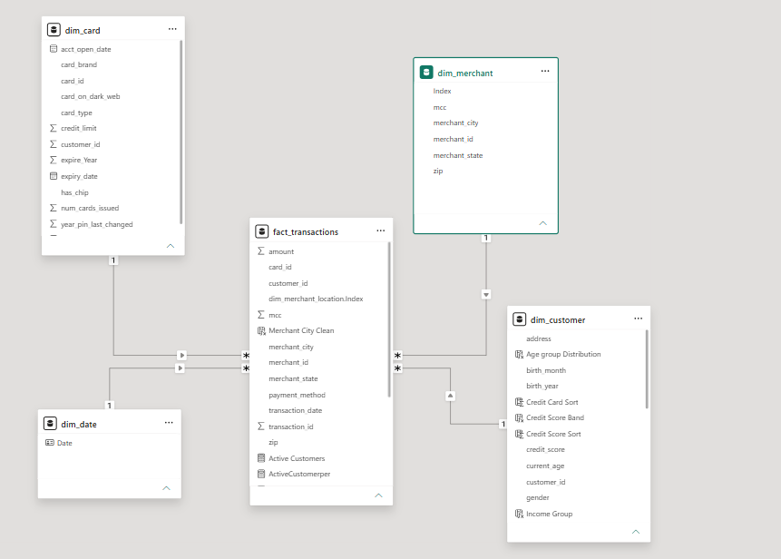

<div align="center">

# Credit Card & Financial Transaction Analytics

### From Raw Financial Data to Business Intelligence

**Microsoft Excel · Python · Pandas · MySQL · Power BI · DAX**

[](https://www.microsoft.com/excel)
[](https://www.python.org/)
[](https://pandas.pydata.org/)
[](https://www.mysql.com/)
[](https://powerbi.microsoft.com/)

**An end-to-end financial analytics project exploring customer credit profiles, card portfolios, transaction behaviour and merchant performance.**

</div>

---

## 01. Project Overview

The **Credit Card & Financial Transaction Analytics** project is an end-to-end data analytics solution designed to transform raw financial datasets into meaningful business insights.

The project follows a structured analytical workflow, beginning with data profiling using Microsoft Excel, followed by data cleaning with Python and Pandas, SQL analysis and validation using MySQL, and interactive business intelligence reporting using Power BI and DAX.

The analysis focuses on customer financial characteristics, credit card distribution, transaction activities, payment preferences and merchant performance.

## 02. Project Objectives

- Analyse customer demographics, income and credit profiles.
- Understand credit card distribution across brands and card types.
- Evaluate transaction volume and transaction value.
- Compare online and swipe payment behaviour.
- Examine merchant and geographical transaction patterns.
- Identify customer financial segments and credit-risk patterns.
- Develop interactive dashboards to communicate business insights.

## 03. Dataset Overview

The project uses three primary datasets.

| Dataset | Description | Records |
|---|---|---:|
| Users | Customer demographic and financial information | 2,000 |
| Cards | Credit and debit card information | 6,146 |
| Transactions | Transaction and merchant information | 100,000 |
| **Total** | | **108,146** |

**Transaction Period:** January 1, 2010 – January 31, 2010.

### Dataset Access

Due to the large size of the datasets, raw and cleaned files are hosted on Google Drive instead of being stored directly in this GitHub repository.

| Dataset | Access |
|---|---|
| Raw Datasets | [Access Raw Data](https://drive.google.com/drive/folders/1omBnBqwacjg1gM-gadTzVmH4Uf-udtIM?usp=sharing) |
| Cleaned Datasets | [Access Cleaned Data](https://drive.google.com/drive/folders/1RYe5s2TtfFGWqE0GA7ib261xkp9CuzQ-?usp=sharing) |

See [`data/README.md`](data/README.md) for download instructions.

## 04. Technology Stack

| Technology | Role |
|---|---|
| Microsoft Excel | Data Profiling |
| Python | Data Cleaning |
| Pandas | Data Manipulation and Transformation |
| MySQL | SQL Analysis and Data Validation |
| Power BI | Data Modelling and Visualization |
| DAX | Measures and Business Calculations |

## 05. End-to-End Workflow

```text
              RAW FINANCIAL DATASETS
                       |
                       ▼
                MICROSOFT EXCEL
                  Data Profiling
                       |
                       ▼
                 PYTHON + PANDAS
             Data Cleaning & Preparation
                       |
                       ▼
                     MYSQL
              SQL Analysis & Validation
                       |
                       ▼
                   POWER BI
                 Data Modelling
                       |
                       ▼
                     DAX
              Measures & Calculations
                       |
                       ▼
              INTERACTIVE DASHBOARDS
                       |
                       ▼
                BUSINESS INSIGHTS
```

## 06. Data Profiling & Cleaning

### Microsoft Excel – Data Profiling

Excel was used for initial inspection and profiling of the raw datasets.

Key activities included:

- Examining dataset structures and column names.
- Reviewing record counts and data types.
- Identifying missing values and inconsistencies.
- Inspecting unique values and categorical distributions.
- Understanding relationships between datasets.

### Python & Pandas – Data Cleaning

Python and Pandas were used to inspect, clean and prepare the datasets.

Three separate scripts were developed:

| Script | Dataset |
|---|---|
| `01_clean_users_data.py` | Users |
| `02_clean_cards_data.py` | Cards |
| `03_clean_transactions_data.py` | Transactions |

The scripts cover data type inspection, financial value conversion, date handling, missing-value checks, duplicate checks and data consistency inspection.

## 07. SQL Analysis & Validation

**Database:** MySQL

SQL was used to analyse customer profiles, card distribution, transactions and merchant activities.

### SQL Business Analysis

- Customer and card analysis.
- Card brand and card type distribution.
- Transaction volume and value analysis.
- Payment method analysis.
- Merchant and geographical analysis.
- Customer spending behaviour.
- Credit and financial profile analysis.

### SQL Data Validation

- Record count verification.
- Duplicate record identification.
- Missing-value inspection.
- Primary and foreign key checks.
- Customer-card relationship validation.
- Transaction amount verification.
- Data consistency checks.

### SQL Scripts

| File | Description |
|---|---|
| [`credit_card_business_analysis.sql`](sql/credit_card_business_analysis.sql) | Business analysis queries |
| [`mysql_data_validation.sql`](sql/mysql_data_validation.sql) | Data validation queries |

## 08. Data Modelling

The project uses three primary analytical entities:

- Users
- Cards
- Transactions

The model connects customer information with card ownership and transaction activity.

### Key Relationships

| Relationship | Join Key |
|---|---|
| Users → Cards | Customer ID |
| Users → Transactions | Customer ID |
| Cards → Transactions | Card ID |

### Data Model Diagram



See [`documentation/Data_Dictionary.md`](documentation/Data_Dictionary.md) for dataset fields and definitions.

## 09. DAX Development

DAX was used to develop calculated measures and calculated columns for business analysis.

Key analytical metrics include:

| Category | Metrics |
|---|---|
| Customer Analytics | Total Customers, Active Customers, Inactive Customers |
| Card Analytics | Total Cards |
| Credit Analytics | Average Credit Score, Average Customer Debt, High Credit-Risk Customers |
| Income Analytics | Average Annual Income, Income Groups |
| Transaction Analytics | Transaction Count, Total Transaction Amount, Average Transaction Value |
| Payment Analytics | Online Transaction Rate |

The consolidated DAX reference is maintained in the repository's [`Dax` file](Dax).

## 10. Power BI Dashboards

Three interactive dashboards were developed to explore different dimensions of the financial data.

### 01 — Executive Overview

**Focus:** Overall financial and customer performance.

Key analytical areas:

- Total customers and credit cards.
- Transaction amount by payment method.
- Transaction amount by card brand.
- Customer gender distribution.
- Active and inactive customer analysis.
- Average customer debt by age group.
- Transaction volume by card type.

**Dashboard Preview**


---

### 02 — Customer & Credit Analysis

**Focus:** Customer financial characteristics and credit-risk segmentation.

Key analytical areas:

- Customer credit score distribution.
- Annual income segmentation.
- Average credit score.
- Average customer debt.
- Average annual income.
- High credit-risk customer identification.
- Debt-to-income ratio analysis.
- Customer financial segmentation matrix.
- Conditional formatting for financial comparisons.

**Dashboard Preview**


---

### 03 — Transaction & Merchant Analysis

**Focus:** Transaction behaviour, merchant activity and geographical performance.

Key analytical areas:

- Total transaction volume.
- Total merchant count.
- Average transaction value.
- Online transaction rate.
- Top 10 cities by transaction volume.
- Regional transaction overview.
- Daily transaction amount trends.

**Dashboard Preview**


## 11. Data Visualization & Interactivity

The dashboards use a combination of:

- KPI cards.
- Bar and column charts.
- Donut charts.
- Line charts.
- Matrix and table visuals.
- Interactive slicers.
- Conditional formatting.
- Data bars and colour scales.

A consistent dark-themed design is maintained across all three dashboard pages.

## 12. Repository Structure

```text
Credit-Card-Financial-Transaction-Analytics/
│
├── README.md
├── cover image.png
│
├── dashboard_screenshots/
│   ├── Executive Overview.jpg
│   ├── Customer & Credit Analysis.jpg
│   └── Transaction & Merchant Analysis.jpg
│
├── pandas/
│   ├── 01_clean_users_data.py
│   ├── 02_clean_cards_data.py
│   └── 03_clean_transactions_data.py
│
├── sql/
│   ├── credit_card_business_analysis.sql
│   └── mysql_data_validation.sql
│
├── Dax
│
├── data/
│   └── README.md
│
└── documentation/
    ├── Data_Model.png
    ├── Data_Dictionary.md
    └── Project_Methodology.md
```

## 13. Documentation

| Document | Description |
|---|---|
| [Data Dictionary](documentation/Data_Dictionary.md) | Dataset columns, definitions and relationships |
| [Project Methodology](documentation/Project_Methodology.md) | End-to-end project workflow |
| [Data Model](documentation/Data_Model.png) | Relational data model diagram |
| [Dataset Access](data/README.md) | Raw and cleaned dataset download links |

## 14. Analytical Considerations

- The transaction dataset covers January 2010 only. Daily transaction trends are therefore used instead of multi-year monthly comparisons.
- Merchant location fields can contain non-geographical or unknown values. These should be interpreted carefully during regional analysis.
- Customer activity classifications are based on the transaction records available in the dataset.
- Financial metrics should be interpreted according to their underlying calculation and data definitions.
- Currency representation should follow the original dataset documentation.

## 15. Skills Demonstrated

**Data Profiling:** Microsoft Excel

**Data Preparation:** Python, Pandas

**Database & Querying:** MySQL, SQL

**Data Modelling:** Power BI relationships and analytical modelling

**Business Intelligence:** Power BI dashboards and DAX

**Analytical Skills:** Customer segmentation, credit analysis, payment behaviour and merchant performance.

---

<div align="center">

### Turning Financial Data into Business Intelligence

**Credit Card & Financial Transaction Analytics**

*Excel · Python · Pandas · MySQL · Power BI · DAX*

</div>
